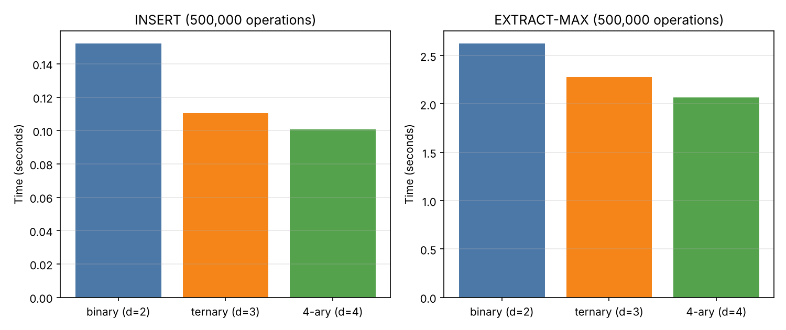

# d-ary Heap Experiment

**CS314 · Heaps — Project: d-ary Heap Experiment (Advanced)**

Compare binary, ternary and 4-ary heaps for `INSERT` and `EXTRACT-MAX`.
Implemented in Python; the benchmark measures both running time and the number of key comparisons.

## The data structure

A d-ary max-heap is stored in a flat list. For the node at index `i`:

- parent: `(i - 1) // d`
- children: `d*i + 1 … d*i + d`

| Operation     | How it works                                                | Cost            |
|---------------|-------------------------------------------------------------|-----------------|
| `INSERT`      | append at the end, sift up (1 comparison per level)         | O(log_d n)      |
| `EXTRACT-MAX` | move last item to the root, sift down by swapping with the largest of the `d` children (up to `d` comparisons per level) | O(d · log_d n) |

Bigger `d` → a shallower tree (cheaper INSERT) but more work per level in EXTRACT-MAX.

## Project structure

```
dary-heap-experiment/
├── dary_heap.py          # DaryHeap class (insert, extract_max, peek, is_valid)
├── benchmark.py          # timing + comparison counts for d = 2, 3, 4
├── test_dary_heap.py     # unit tests (checked against heapq)
├── results/
│   ├── results.csv       # raw numbers
│   └── heaps.png         # bar charts
├── requirements.txt
├── LICENSE
└── README.md
```

## Usage

```bash
pip install -r requirements.txt     # only needed for the plot

python dary_heap.py                 # tiny demo
python -m unittest -v               # run the tests
python benchmark.py                 # run the experiment (writes results/)

# custom sizes / heaps
python benchmark.py --sizes 200000 1000000 --ds 2 3 4 8 --repeats 5
```

```python
from dary_heap import DaryHeap

h = DaryHeap(d=4)
for x in [5, 1, 9, 3]:
    h.insert(x)
print(h.extract_max())   # 9
```

## Results

Python 3.13, random integers, best of 3 runs. Time in seconds (key comparisons in parentheses).

| n       | d | INSERT              | EXTRACT-MAX          |
|---------|---|---------------------|----------------------|
| 100,000 | 2 | 0.030 s (228,593)   | 0.389 s (2,831,674)  |
| 100,000 | 3 | 0.024 s (174,334)   | 0.330 s (2,750,506)  |
| 100,000 | 4 | 0.021 s (154,595)   | 0.290 s (2,946,218)  |
| 500,000 | 2 | 0.152 s (1,141,817) | 2.623 s (16,456,195) |
| 500,000 | 3 | 0.111 s (870,310)   | 2.277 s (15,998,208) |
| 500,000 | 4 | 0.101 s (772,612)   | 2.065 s (17,088,746) |



> Timings depend on your machine. Re-run `python benchmark.py` and update the table with your own numbers.

## Analysis

- **INSERT gets cheaper as d grows.** The tree has fewer levels, so the new element is sifted up fewer times: comparisons drop by about 32 % going from d=2 to d=4, and time drops by about 33 %.
- **EXTRACT-MAX comparisons do not follow a simple rule.** Each level costs more comparisons (about `d`), but there are fewer levels. The count is lowest for d=3 and highest for d=4, so the trade-off is close to a tie between 2, 3 and 4.
- **In Python the 4-ary heap was still the fastest for EXTRACT-MAX** (about 21 % faster than binary at 500,000 elements), even though it did slightly more comparisons. Fewer levels means fewer iterations of the interpreted `while` loop and fewer element moves, and in CPython that costs more than the extra comparisons. In C++ the picture can differ, and 4-ary heaps are known to also benefit from better cache behaviour because the `d` children are stored next to each other.
- **Conclusion:** for workloads with many inserts (or `decrease-key` operations, as in Dijkstra/Prim) a larger `d` is better. For workloads dominated by extract-max, d between 3 and 4 is a good choice, and very large `d` eventually loses because of the `d` comparisons per level.

## License

MIT
